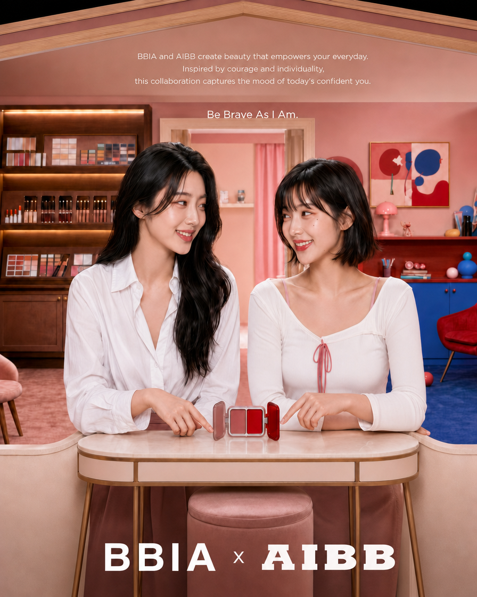
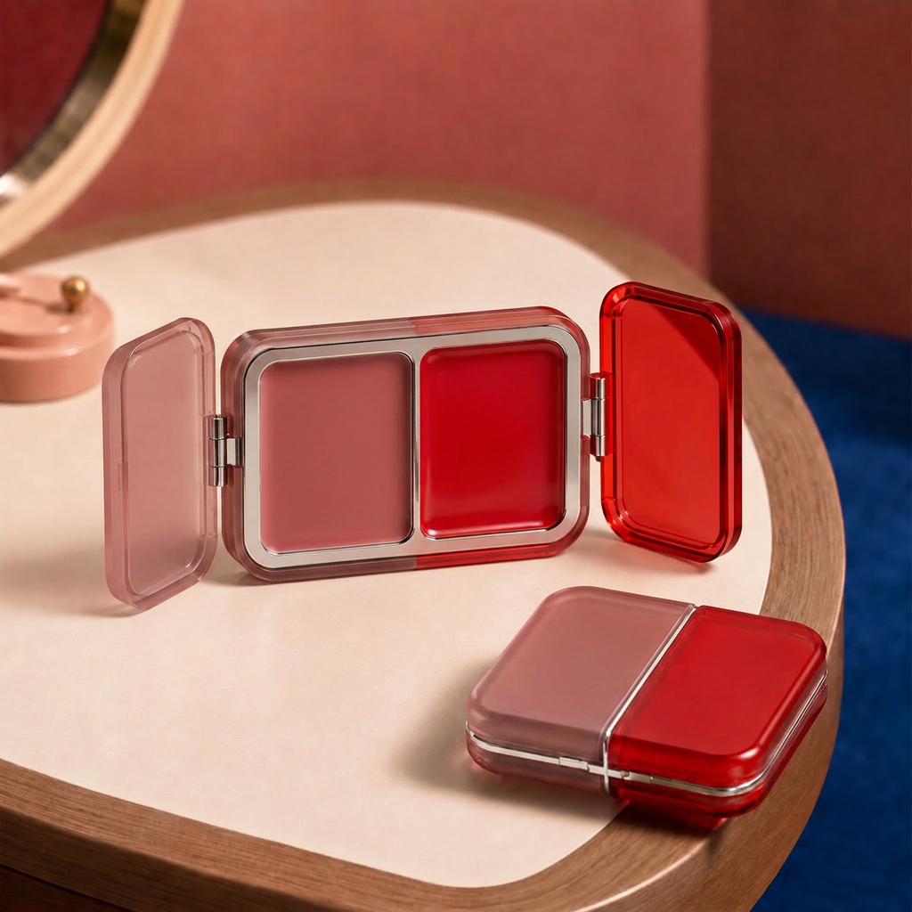
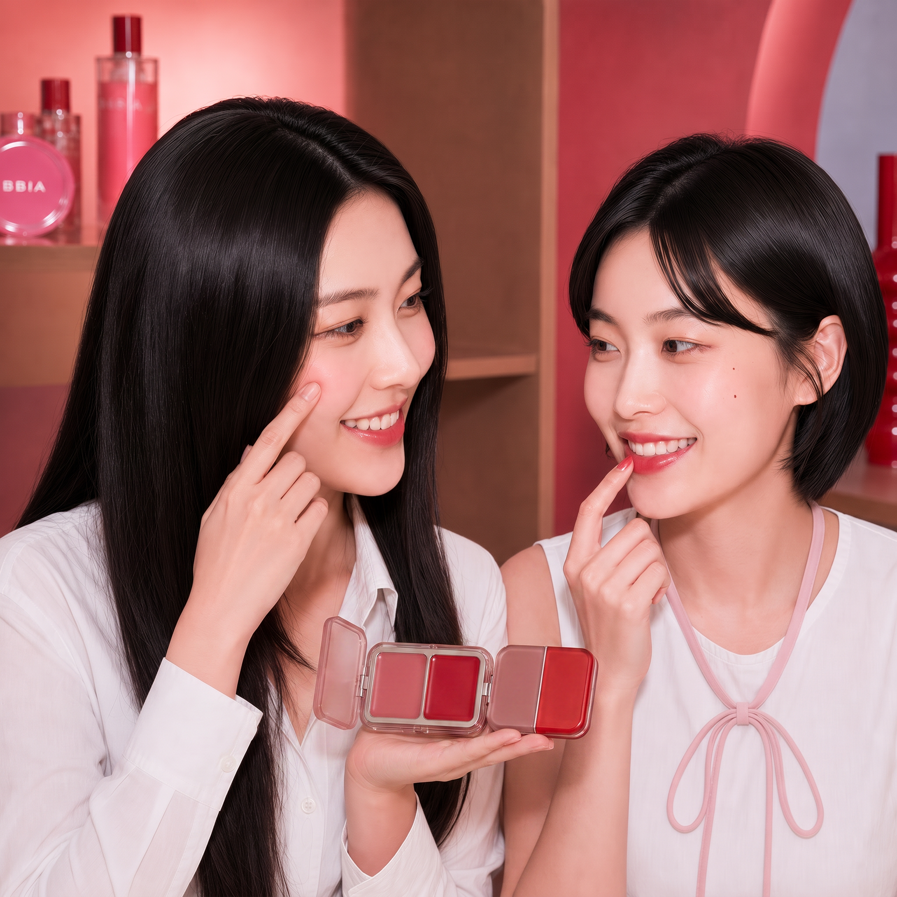
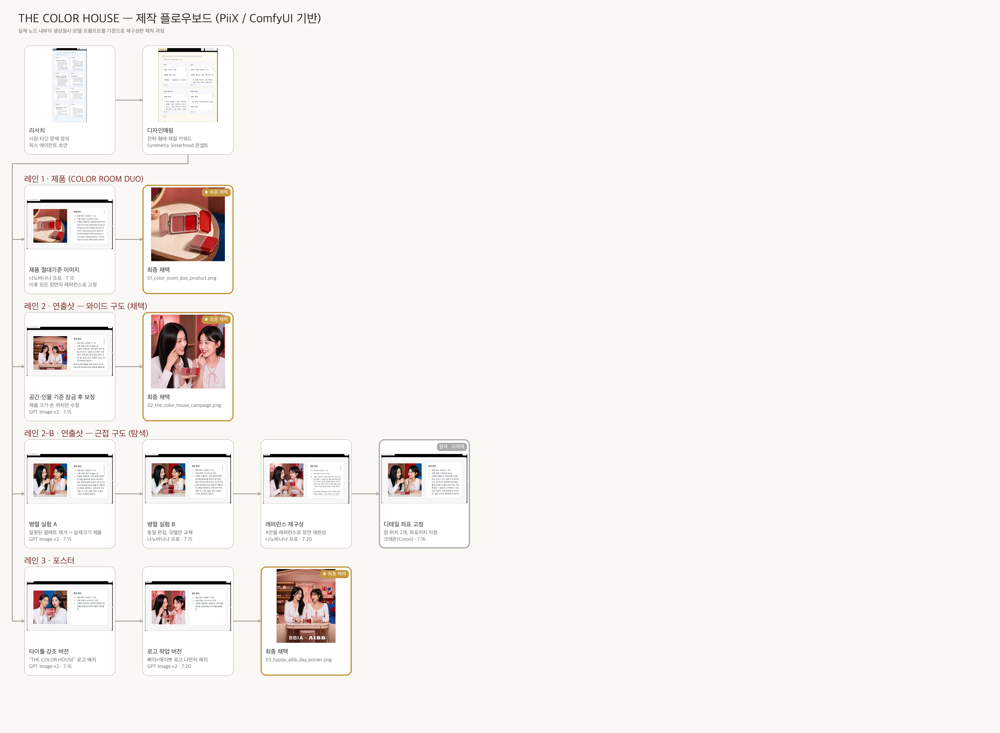

# THE COLOR HOUSE

> **BBIA × AIBB의 One DNA를 하나의 집, 두 개의 컬러룸, 하나의 듀얼 콤팩트로 번역한 2026 AIBB 1주년 캠페인 제안**



## 프로젝트 한눈에 보기

| 항목 | 내용 |
|---|---|
| 프로젝트 | BBIA × AIBB × PiiX AI 공모전 — AIBB 1주년 기념 캠페인 |
| 작업 기간 | 2026.07.13–2026.07.21 |
| 캠페인명 | `THE COLOR HOUSE` |
| 제품명 | `COLOR ROOM DUO` |
| 핵심 메시지 | `One DNA, Two Color Rooms.` |
| 한국어 카피 | `닮은 우리, 다른 색의 방.` |
| 담당 | 브랜드 리서치, 콘셉트 기획, 제품 디자인, 프롬프트 설계, 아트 디렉션, 이미지 선별·검수, 문서화 |
| 제작 환경 | PiiX 중심 AI 이미지 워크플로우, 이미지 생성·보정 도구, Markdown, Git/GitHub |
| 최종 산출물 | 제품 최종 시안 1개, 연출 이미지 1개, 4:5 포스터 1개 |

## 공모전 개요

`HAPPY AIBB DAY!`는 AIBB의 1주년을 기념해 자매 브랜드 BBIA와 AIBB가 협업 제품을 출시하고 생일 캠페인을 연다는 설정의 AI 디자인 공모전이다.

- 모집 기간: 2026.07.13–2026.08.21 23:59
- 심사 기간: 2026.08.24–2026.09.04
- 결과 발표: 2026.09.11
- 총상금: 500만 원, 총 8팀
- 필수 제출물:
  1. 콜라보 제품 최종 시안 1개
  2. 제품·모델·무드 연출 이미지 1–3개
  3. AIBB 1주년 생일 파티 포스터 1개
  4. 제품명, 디자인 의도, 디자인 콘셉트, 캠페인 키워드
- 심사 기준:
  - 비주얼 완성도·활용성 40%
  - 브랜드·주제 해석력 30%
  - 디자인 기획력 30%

## 디자인 과제

두 브랜드를 단순히 나란히 배치하는 것만으로는 `One DNA`를 설명하기 어려웠다. 또한 BBIA와 AIBB를 하나로 섞으면 각 브랜드가 가진 컬러와 태도의 차이가 사라질 수 있었다.

이 프로젝트는 다음 질문에서 출발했다.

> 닮았지만 서로 다른 두 자매 브랜드의 관계를, 제품을 열고 사용하는 경험으로 어떻게 보여줄 수 있을까?

해답은 하나의 집 안에 연결된 두 개의 방이었다. BBIA는 차분하게 색을 축적한 언니의 방, AIBB는 선명한 색을 자유롭게 선택하는 동생의 방이다. 두 방은 중앙의 공용 화장대에서 만나고, 이 공간 구조는 그대로 하나의 듀얼 립앤치크 콤팩트로 축소된다.

## 핵심 콘셉트

### One DNA, Two Color Rooms.

- **왼쪽 BBIA:** 더스티 로즈, 뮤트 블러, 정돈된 컬러 아카이브
- **오른쪽 AIBB:** 체리 레드, 투명한 글로우, 자유로운 컬러 선택
- **중앙:** 두 방을 연결하는 통로이자 제품의 실버 세로 이음선
- **관계:** BBIA는 언니, AIBB는 동생
- **표현 원칙:** 공식 로고를 뒤집지 않고 공간·제품·인물의 좌우 대응으로 이름의 대칭성을 표현

## 제품 — COLOR ROOM DUO



`COLOR ROOM DUO`는 손바닥 크기의 얇고 둥근 직사각형 듀얼 립앤치크 콤팩트다.

- 하나의 고정 베이스 안에 두 개의 반쪽 팬을 좌우로 배치
- 왼쪽: BBIA 뮤트 로즈 블러 립앤치크
- 오른쪽: AIBB 체리 레드 글로우 립앤치크
- 왼쪽·오른쪽 바깥 가장자리의 독립 힌지
- 닫으면 중앙의 얇은 실버 세로 이음선에서 만나는 양문 구조
- 핑크 뚜껑–핑크 팬, 레드 뚜껑–레드 팬의 직관적인 대응
- 블러와 글로우를 단독 또는 레이어링해 사용할 수 있는 구성

제품을 여는 행위는 두 자매가 각자의 방을 열고 중앙에서 만나는 캠페인 서사를 손안에서 반복하는 경험이다.

## 캠페인 연출



연출 이미지는 BBIA 언니와 AIBB 동생이 서로를 바라보며 각자의 컬러를 사용하는 순간을 담았다. 배경의 로즈와 레드, 두 사람의 헤어와 메이크업, 제품의 좌우 컬러가 같은 축으로 연결된다. 제품은 두 사람 사이의 공통 오브제로 배치해 자매 관계와 사용 맥락을 동시에 읽히게 했다.

## 포스터


포스터는 하나의 집 안에 BBIA와 AIBB의 방을 함께 보여준다. 중앙 통로와 화장대, 좌우 인물, 제품, 대형 브랜드 락업을 하나의 세로형 캠페인 화면으로 구성해 AIBB 1주년 협업의 축제성과 제품 서사를 연결했다.

## 제작 과정 요약

1. 공모전 요강과 공식 BI 자료 정리
2. BBIA·AIBB의 공통점과 차이 분석
3. 초기 제품 아이디어 비교와 범위 축소
4. `THE COLOR HOUSE` 캠페인 콘셉트 확정
5. 자매 캐릭터·두 개의 방·중앙 화장대 구축
6. 공간의 대칭 구조를 `COLOR ROOM DUO` 제품 구조로 번역
7. PiiX 플로우보드에서 제품 시안과 연출·포스터 전개
8. 얼굴, 손, 제품 크기, 팬과 뚜껑의 대응, 힌지 구조를 반복 검수
9. 최종 품질 보정과 제출 파일 확정
10. 작업 기록 정리 및 GitHub 아카이빙

자세한 과정과 의사결정은 [REPORT.md](REPORT.md)에서 확인할 수 있다.

## 제작 플로우보드



PiiX(ComfyUI 기반) 플로우보드에서 실제로 분기한 생성 노드들을 제품·연출샷·포스터 3개 레인으로 재구성했다. 각 레인은 리서치·디자인매핑 단계를 공유하고, 반복 보정을 거쳐 최종 채택 파일(위 `최종 파일` 표의 3개)로 수렴한다. 연출샷에서는 와이드 구도(채택)와 근접 구도(탐색 후 미채택) 두 방향을 병행 실험했고, 제품 이미지는 하나의 절대기준 이미지를 고정한 뒤 모든 후속 장면의 레퍼런스로 사용했다. 순서는 각 노드에 남은 생성일시·모델·프롬프트를 기준으로 재구성한 것으로, 내보내지 않은 일부 중간 노드는 생략했다.

## 최종 파일

```text
assets/final/
├── 01_color_room_duo_product.png
├── 02_the_color_house_campaign.png
└── 03_happy_aibb_day_poster.png
```

| 파일 | 규격 | SHA-256 |
|---|---:|---|
| `01_color_room_duo_product.png` | 1024×1024 | `555594def1ec825a3053d44996d1c1e65f518bcd5797661695339128cd898e61` |
| `02_the_color_house_campaign.png` | 2048×2048 | `cc862311e892e8d3298f0d94bfea69435405f1388aa8a9e921cb2012835c8de0` |
| `03_happy_aibb_day_poster.png` | 896×1120 | `19fb57e441d47a7f2a6696352c7ab9604f7003ba2d95c0ced9708084322c6d15` |

## 핵심 학습

- 생성형 이미지에서는 멋진 한 장보다 제품 구조의 반복 가능성이 더 어렵다.
- 인물·공간·제품을 한 번에 고치기보다 절대 기준 이미지를 분리해야 일관성을 관리하기 쉽다.
- 프롬프트의 형용사보다 `좌우 위치`, `색상 대응`, `힌지 위치`, `점의 개수`처럼 검증 가능한 규칙이 중요하다.
- 포스터는 문자를 생성 모델에 전적으로 맡기기보다 이미지와 타이포그래피의 역할을 분리해 검수해야 한다.
- 최종 선택에서는 생성 과정의 비용보다 브랜드 해석과 시각적 완성도를 우선해야 한다.

## 안내

이 저장소는 공모전 출품 및 개인 포트폴리오를 위한 비상업적 프로젝트 기록이다. BBIA, AIBB, PiiX 및 관련 로고·상표의 권리는 각 권리자에게 있다. 저장소에는 공식 제공 원문 자료와 원본 레퍼런스를 포함하지 않고, 프로젝트 설명과 최종 창작 결과만 수록했다.
