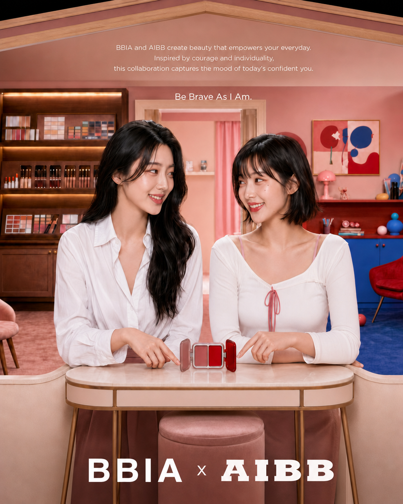
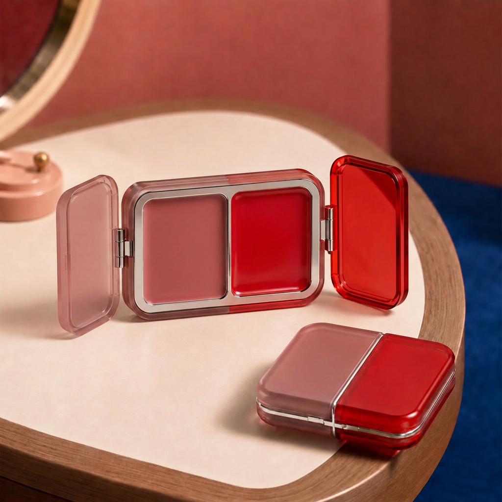
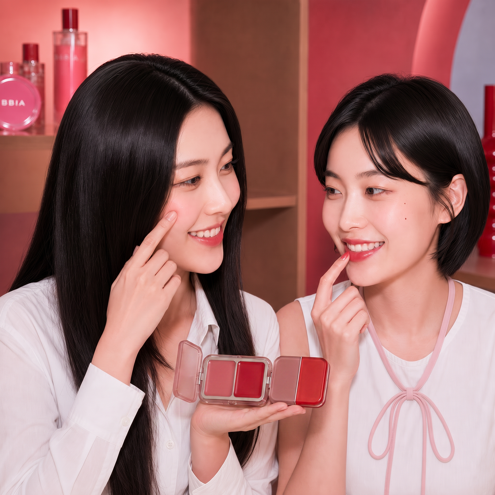

# THE COLOR HOUSE — Project Report

> BBIA × AIBB × PiiX AI 공모전을 위해 기획한 AIBB 1주년 콜라보 제품과 캠페인 비주얼의 전체 제작 기록



## 1. 프로젝트 개요

### 1.1 기본 정보

- 프로젝트명: `THE COLOR HOUSE`
- 제품명: `COLOR ROOM DUO`
- 캠페인 메시지: `One DNA, Two Color Rooms.`
- 한국어 카피: `닮은 우리, 다른 색의 방.`
- 작업 기간: 2026.07.13–2026.07.21
- 프로젝트 유형: AI 기반 브랜드 협업 제품·캠페인 디자인
- 참여 형태: 개인 작업
- 결과: 미수상 (2026.09.11 발표)
- 담당 범위:
  - 공모전 요강 분석
  - 브랜드·시장 리서치
  - 콘셉트 및 제품 기획
  - 제품 구조·CMF 설계
  - 캐릭터와 공간 아트 디렉션
  - 프롬프트 설계와 생성 결과 검수
  - 최종 이미지 선별 및 품질 보정
  - 제출 문구와 프로젝트 문서 작성

### 1.2 결과물

프로젝트는 서로 다른 역할을 가진 세 장의 최종 이미지로 완성했다.

1. 제품의 구조와 CMF를 보여주는 최종 시안
2. 두 자매와 제품 사용 맥락을 보여주는 연출 이미지
3. AIBB 1주년 캠페인의 세계관을 압축한 4:5 포스터

세 이미지는 같은 컬러 대비와 자매 서사를 공유하지만, 동일한 장면을 중복 사용하지 않는다.

---

## 2. 공모전 분석

### 2.1 주제

공모전의 핵심 설정은 AIBB의 1주년을 맞아 자매 브랜드 BBIA와 AIBB가 콜라보레이션 제품을 출시하고 생일 캠페인을 진행한다는 것이다. 단순히 예쁜 화장품 이미지를 만드는 것이 아니라, 두 브랜드의 `One DNA`를 해석한 제품과 캠페인 시스템을 제안해야 했다.

### 2.2 일정

| 단계 | 일정 |
|---|---|
| 모집 | 2026.07.13–2026.08.21 23:59 |
| 심사 | 2026.08.24–2026.09.04 |
| 결과 발표 | 2026.09.11 |

### 2.3 제출 요구사항

- BBIA × AIBB 콜라보 제품 최종 시안 1개
- 제품·모델·무드 연출 이미지 1–3개
- AIBB 1주년 생일 파티 포스터 1개
- 제품명, 디자인 의도, 디자인 콘셉트, 캠페인 키워드
- 동일 이미지를 여러 제출 항목에 중복 선택할 수 없음
- PiiX 플로우보드를 활용한 제작 과정 필요

### 2.4 심사 기준에 따른 우선순위

| 심사 항목 | 비중 | 프로젝트 대응 |
|---|---:|---|
| 비주얼 완성도·활용성 | 40% | 제품·연출·포스터를 실제 캠페인 세트처럼 통일 |
| 브랜드·주제 해석력 | 30% | 자매 관계와 이름의 대칭성을 공간·제품 구조로 번역 |
| 디자인 기획력 | 30% | 제품의 사용 방식과 캠페인 서사가 같은 원리로 작동하도록 설계 |

가장 높은 비중은 비주얼 완성도였지만, 브랜드 해석과 제품 기획이 약하면 세 이미지가 서로 다른 AI 생성물처럼 흩어질 위험이 있었다. 따라서 초반에는 생성보다 `왜 이런 구조와 색이어야 하는가`를 먼저 고정했다.

### 2.5 시상 정보

- 총상금 500만 원
- 총 8팀 수상
- 1등 1팀 200만 원
- 2등 1팀 100만 원
- 3등 2팀 각 50만 원
- 특별상 4팀 각 25만 원

---

## 3. 브랜드 해석

### 3.1 두 브랜드의 관계

BBIA와 AIBB는 이름부터 서로를 반대로 비추는 구조를 갖는다. `BBIA`를 반대 방향으로 읽으면 `AIBB`가 된다. 하지만 공식 로고를 실제로 뒤집는 방식은 BI를 훼손할 수 있으므로 사용하지 않았다.

대신 이름의 대칭성을 다음 요소로 옮겼다.

- 왼쪽과 오른쪽으로 나뉜 두 방
- 중앙의 문과 공용 화장대
- 왼쪽과 오른쪽에 배치된 두 자매
- 핑크와 레드로 나뉜 듀얼 제품
- 제품 중앙의 얇은 실버 세로 이음선

즉, 로고의 문자를 변형하지 않고 캠페인 전체가 하나의 거울 구조처럼 작동하게 했다.

### 3.2 BBIA — 언니의 방

BBIA는 축적된 컬러 경험과 정돈된 태도를 가진 언니로 해석했다.

- 더스티 로즈와 소프트 핑크
- 따뜻한 원목과 정리된 메이크업 아카이브
- 뮤트한 블러 제형
- 긴 검은 머리와 차분한 인상
- 컬러를 고르고 정리하는 성숙한 태도

### 3.3 AIBB — 동생의 방

AIBB는 색을 수집하고 바로 시도하는 자유로운 동생으로 설정했다.

- 체리 레드와 캔디 핑크
- 딥 블루 카펫과 키치한 컬러 오브제
- 촉촉하고 투명한 글로우 제형
- 짙은 브라운 단발과 앞머리
- 자신에게 맞는 색을 빠르게 선택하는 태도

AIBB 캐릭터의 왼쪽 볼, 즉 관람자 기준 얼굴 오른쪽에는 두 개의 시그니처 점을 고정했다. 이처럼 작은 특징도 이미지마다 사라지거나 늘어날 수 있어 별도의 검수 항목으로 관리했다.

### 3.4 한 문장으로 압축하기

브랜드 분석을 거쳐 최종 메시지를 다음과 같이 압축했다.

> 하나의 DNA를 공유하지만 서로 다른 방식으로 색을 선택하는 두 자매.

이 문장은 캠페인 슬로건 `One DNA, Two Color Rooms.`와 제품의 좌우 이중 구조를 동시에 설명한다.

---

## 4. 문제 정의

### 4.1 기능적 문제

립과 치크에 모두 사용할 수 있는 블러·글로우 제품을 각각 들고 다니면 파우치 부피가 커지고 두 제품을 따로 관리해야 한다. 단순한 듀얼 제품도 어느 뚜껑과 어느 내용물이 연결되는지 직관적으로 알기 어려울 수 있다.

### 4.2 인지적 문제

왼쪽과 오른쪽의 브랜드·컬러·제형 대응이 고정되지 않으면 사용자는 제품을 열어 확인해야 한다. 빠른 터치업이라는 사용 맥락과 맞지 않는다.

### 4.3 정서적 문제

두 브랜드 이름만 하나의 패키지에 병기하면 협업 이유가 약하다. 사용자가 제품을 열고 색을 선택하는 행동 자체에서 자매 관계를 경험할 수 있어야 했다.

### 4.4 디자인 질문

문제 정의는 하나의 질문으로 정리됐다.

> 블러와 글로우, 언니와 동생, 핑크와 레드를 하나의 제품에 담되 서로의 차이를 지우지 않는 방법은 무엇인가?

---

## 5. 초기 탐색과 방향 전환

초기에는 두 개의 팟이나 키링형 구조처럼 제품 자체의 결합 방식에 집중했다. 하지만 다음 문제가 있었다.

- 기존 듀얼 화장품과 차별성이 약함
- 브랜드의 자매 관계보다 용기 기능이 먼저 보임
- 캠페인 포스터와 인물 연출로 확장할 세계관이 부족함
- 제품과 공간을 같은 규칙으로 연결하기 어려움

여러 구조를 비교한 결과, 제품만 먼저 완성하는 접근을 중단했다. 먼저 자매가 살아가는 하나의 캠페인 공간을 만들고, 그 공간을 제품으로 축소하는 순서로 전환했다.

이 전환에서 나온 개념이 `THE COLOR HOUSE`다.

```text
하나의 집
├── 왼쪽: BBIA의 컬러룸
├── 중앙: 두 방을 연결하는 통로와 화장대
└── 오른쪽: AIBB의 컬러룸

하나의 제품
├── 왼쪽: BBIA 블러 파트
├── 중앙: 실버 이음선
└── 오른쪽: AIBB 글로우 파트
```

공간과 제품이 같은 문법을 사용하면서 캠페인·제품·포스터가 하나의 시스템으로 묶이기 시작했다.

---

## 6. 캠페인 콘셉트 — THE COLOR HOUSE

### 6.1 공간 설정

`THE COLOR HOUSE`는 실제 크기의 인형의 집 세트처럼 보이는 하나의 집이다. 두 방은 분리돼 있지만 중앙 통로로 연결된다.

- 왼쪽 방은 BBIA의 정돈된 로즈 컬러 아카이브
- 오른쪽 방은 AIBB의 자유로운 레드·블루 컬러 컬렉션
- 중앙에는 두 사람이 함께 사용하는 화장대
- 같은 가구 언어를 공유하되 색과 사용 방식은 다르게 구성

### 6.2 자매 서사

BBIA 언니가 동생에게 정답을 알려주는 관계로 만들지 않았다. 두 사람은 각자의 색을 선택하고 서로의 선택을 바라본다. 이를 통해 AIBB의 자기 선택 메시지와 BBIA의 축적된 컬러 경험이 수평적으로 만난다.

### 6.3 캠페인 메시지

- 영문: `One DNA, Two Color Rooms.`
- 한국어: `닮은 우리, 다른 색의 방.`

두 문장은 닮음과 다름을 동시에 말한다. 하나의 DNA는 브랜드의 연결을, 두 개의 방은 독립적인 컬러 태도를 뜻한다.

---

## 7. 제품 디자인 — COLOR ROOM DUO



### 7.1 제품 정의

`COLOR ROOM DUO`는 하나의 고정 베이스에 블러와 글로우 두 제형을 담은 듀얼 립앤치크 콤팩트다. 손바닥 크기의 얇고 둥근 직사각형으로 설계했다.

### 7.2 구조

- 동일한 너비의 반쪽 팬 두 개를 좌우로 배치
- 각 팬마다 독립된 반쪽 뚜껑 제공
- 실제 회전 힌지는 베이스의 왼쪽·오른쪽 바깥 가장자리에 배치
- 두 뚜껑은 캐비닛 양문처럼 바깥으로 열림
- 닫으면 중앙의 실버 세로 이음선에서 만나 하나의 콤팩트가 됨
- 중앙을 책처럼 접는 힌지 구조는 사용하지 않음

### 7.3 좌우 대응

| 위치 | 브랜드 | 색 | 제형 | 표면 인상 |
|---|---|---|---|---|
| 왼쪽 | BBIA | 뮤트 로즈 | 블러 립앤치크 크림 | 프로스티드, 차분함, 보송함 |
| 오른쪽 | AIBB | 체리 레드 | 글로우 립앤치크 밤 | 투명 젤리, 선명함, 촉촉함 |

핑크 뚜껑 아래에는 핑크 팬, 레드 뚜껑 아래에는 레드 팬이 놓인다. 사용자가 열기 전에도 색과 제형을 예상할 수 있도록 했다.

### 7.4 사용 경험

사용자는 상황에 따라 세 가지 방식으로 제품을 사용할 수 있다.

1. 왼쪽 블러만 사용해 차분한 데일리 룩 완성
2. 오른쪽 글로우만 사용해 생기 있는 포인트 추가
3. 블러 위에 글로우를 레이어링해 자신만의 컬러와 질감 구성

두 도어가 독립적으로 열리기 때문에 사용하지 않는 팬은 닫아둘 수 있다. 구조는 브랜드 서사를 표현하는 동시에 두 제형의 선택적 사용을 지원한다.

### 7.5 CMF

- BBIA: 프로스티드 더스티 로즈, 무광·소프트터치 인상
- AIBB: 투명 젤리 레드, 하이글로시 인상
- 중앙과 팬 테두리: 새틴 실버
- 외곽: 파우치 안에서 걸리지 않는 부드러운 라운드
- 그래픽: 제품 자체의 색상 분할이 주인공이 되도록 최소화

### 7.6 생산 관점

콘셉트 단계에서도 다음 항목을 고려했다.

- 서로 다른 점도와 유분을 가진 두 제형의 격리
- 도어별 밀폐 구조
- 외곽 힌지의 내구성과 사출 공차
- 손바닥 크기의 슬림한 두께
- 닫힌 상태와 열린 상태 사이의 구조 일관성

실제 양산을 위해서는 금형 시제품을 통한 힌지·잠금·기밀성 검증이 필요하다.

---

## 8. 시각 시스템

### 8.1 캐릭터 일관성

두 자매는 닮았지만 같은 사람처럼 보이지 않게 설계했다.

- BBIA 언니: 긴 검은 머리, 뮤트 로즈 메이크업, 차분한 표정
- AIBB 동생: 짙은 단발과 앞머리, 체리 글로우 메이크업, 두 개의 시그니처 점

생성 과정에서 얼굴을 고정하는 것만으로는 부족했다. 헤어 길이, 앞머리, 점의 방향, 메이크업 질감과 좌우 위치를 각각 명시하고 검수했다.

### 8.2 컬러 시스템

```text
BBIA room  → dusty rose / soft pink / warm wood
Shared axis → satin silver / warm neutral
AIBB room  → cherry red / candy pink / deep blue
```

두 방을 모두 핑크·레드로만 채우면 구분이 약해진다. AIBB 방에 딥 블루를 넣어 레드의 선명도를 높이고, BBIA 방에는 원목과 뉴트럴을 넣어 축적된 느낌을 만들었다.

### 8.3 대칭과 비대칭

기본 구조는 대칭이지만 모든 디테일을 거울처럼 복제하지 않았다.

- 집과 제품의 큰 구조는 좌우 대응
- 가구의 사용 흔적과 소품은 각자의 성격에 따라 다르게 배치
- 자매의 얼굴과 포즈는 자연스러운 차이를 유지
- 색과 제형은 명확히 대비

이 방식으로 `One DNA`와 `Two Color Rooms`가 동시에 읽히게 했다.

---

## 9. 제작 워크플로우

### 9.1 1단계 — 공식 자료 정리

공모전 요강, 브랜드 소개, BI 가이드와 제출 조건을 먼저 문서화했다. 공식 표기 `BBIA`와 기존 폴더명에 섞여 있던 오기 `BIAA`를 구분하고, 최종 제출물에서는 공식 표기만 사용하도록 규칙을 고정했다.

### 9.2 2단계 — 레퍼런스 분리

레퍼런스를 한 장에 모두 넣는 대신 역할별로 나눴다.

- 얼굴 기준
- 공간과 촬영 무드 기준
- 브랜드 제품·컬러 기준
- 제품 구조 기준
- 공식 로고 기준

이 분리는 생성 모델이 제품보드의 레이아웃이나 텍스트를 장면에 복제하는 문제를 줄이는 데 도움이 됐다.

### 9.3 3단계 — 캐릭터 구축

BBIA 언니와 AIBB 동생을 먼저 확정했다. 이후 공간과 제품 이미지는 이 캐릭터 기준을 참조했다. AIBB 점 두 개처럼 작은 특징도 별도의 합격 기준으로 두었다.

### 9.4 4단계 — 공간 구축

하나의 집 안에 두 방이 있고 중앙에서 연결되는 구조를 만들었다. 이 단계에서는 인물보다 집의 읽힘, 좌우 색상 구분과 공용 화장대의 위치를 우선 검수했다.

### 9.5 5단계 — 제품 구조 확정

초기 생성에서는 중앙이 책처럼 접히거나 팬과 뚜껑의 색이 뒤바뀌는 문제가 반복됐다. 이를 해결하기 위해 제품 규칙을 검증 가능한 문장으로 바꿨다.

- 팬은 정확히 두 개
- 왼쪽 핑크, 오른쪽 레드
- 핑크 뚜껑 아래 핑크 팬
- 레드 뚜껑 아래 레드 팬
- 힌지는 중앙이 아니라 양쪽 바깥 가장자리
- 중앙은 실버 이음선

형용사를 늘리는 것보다 이런 구조 규칙을 반복하는 편이 효과적이었다.

### 9.6 6단계 — 리서치와 디자인 매핑

PiiX의 리서치·디자인 매핑 흐름을 이용해 시장, 타깃, 문제, 솔루션, 형태, 재질, 색상과 환경을 정리했다. 자동 생성된 내용 중 콘셉트와 충돌하는 중앙 힌지나 과도한 직선형 제품 설명은 직접 수정했다.

이 단계에서 확정된 핵심 키워드는 다음과 같다.

- Symmetry Sisterhood
- Transparent Color Contrast
- Dual-Chamber Sealing
- Palm-sized Portability
- Kitsch Premium

### 9.7 7단계 — 제품 이미지 생성

제품 단독 이미지는 형태와 CMF를 가장 명확하게 보여주는 결과를 선택했다. 열린 제품과 닫힌 제품을 같은 프레임에 배치해 양쪽 상태가 동일한 제품임을 보여줬다.

### 9.8 8단계 — 연출 이미지 생성

연출 단계에서는 제품이 지나치게 커지거나 손이 제품을 가리는 문제가 발생했다. 제품의 실제 크기를 수치와 비교 대상으로 명시하고, 인물과 제품의 시각적 우선순위를 조정했다.

최종 연출은 두 자매가 서로를 바라보며 각자의 컬러를 사용하는 장면으로 정리했다. 제출 전에는 전체 구도와 제품 노출을 중심으로 최종 품질을 다듬었다.

### 9.9 9단계 — 포스터

포스터에서는 집, 자매, 제품과 브랜드 락업이 한 화면에서 읽혀야 했다. 여러 조판 방향을 비교했고, 최종적으로 사진과 타이포그래피가 하나의 캠페인 장면처럼 결합되는 구도를 선택했다. 제출본은 세로 4:5 규격으로 확정했다.

### 9.10 10단계 — 최종 QA

최종 검수표는 다음과 같았다.

- BBIA가 왼쪽, AIBB가 오른쪽인가
- AIBB의 점이 올바른 볼에 두 개인가
- 제품 팬이 정확히 두 개인가
- 핑크와 레드의 좌우 대응이 유지되는가
- 중앙이 힌지가 아니라 실버 이음선인가
- 얼굴과 손이 자연스러운가
- 제품 크기가 현실적인가
- 세 이미지가 동일한 캠페인처럼 보이는가
- 공식 브랜드 철자가 정확한가
- 동일 이미지를 제출 항목에 중복 사용하지 않았는가

---

## 10. 최종 결과

### 10.1 제품 최종 시안


열린 제품과 닫힌 제품을 함께 보여줘 구조와 휴대 형태를 동시에 전달한다. 프로스티드 로즈와 투명 레드의 소재 대비, 두 팬의 제형 차이, 양쪽 외곽 힌지가 핵심이다.

### 10.2 연출 이미지



두 자매가 서로를 바라보며 블러와 글로우를 사용하는 장면이다. 제품은 두 인물 사이에 놓여 관계를 연결하고, 배경의 로즈·레드 컬러는 각자의 제품 파트와 이어진다.

### 10.3 포스터


인형의 집 같은 세트와 중앙 통로, 두 자매, 공용 화장대와 제품을 하나의 4:5 화면으로 구성했다. 제품 단독 이미지와 연출 이미지에서 만든 관계를 캠페인 포스터로 확장한다.

---

## 11. 심사 기준에 대한 최종 대응

### 11.1 브랜드·주제 해석력 30%

- BBIA와 AIBB를 언니와 동생으로 명확히 설정
- 이름의 대칭성을 로고 변형이 아닌 공간·제품 구조로 표현
- AIBB 1주년을 두 브랜드가 만나는 새로운 방의 시작으로 해석
- `One DNA`와 서로 다른 컬러 태도를 동시에 유지

### 11.2 디자인 기획력 30%

- 캠페인 공간과 제품 구조가 같은 좌우·중앙 문법을 사용
- 블러와 글로우의 기능 차이를 CMF와 사용 방식에 반영
- 독립 도어와 고정된 좌우 대응으로 빠른 선택과 레이어링 지원
- 제품명, 캠페인명, 슬로건과 비주얼 시스템을 하나의 서사로 연결

### 11.3 비주얼 완성도·활용성 40%

- 제품 단독, 모델 연출, 4:5 포스터의 역할을 분리
- SNS 피드, 상세 페이지, 캠페인 키비주얼로 확장 가능한 구성
- 로즈·레드·실버 컬러 시스템을 세 이미지에 반복
- 인물과 제품이 함께 등장해 실제 사용 맥락 전달

---

## 12. 시행착오와 해결

### 12.1 제품 구조가 계속 바뀌는 문제

**문제:** 중앙 힌지, 추가 팬, 뒤바뀐 뚜껑과 팬이 반복적으로 생성됐다.

**해결:** 제품 설명을 감성 표현과 구조 규칙으로 분리했다. `왼쪽/오른쪽`, `두 개`, `바깥 힌지`, `중앙 이음선`처럼 출력 전 확인이 가능한 문장을 사용했다.

### 12.2 제품이 소품처럼 커지는 문제

**문제:** 연출 장면에서 제품이 30cm 이상의 디스플레이 오브제처럼 커졌다.

**해결:** 손바닥 크기, 닫힌 폭, 사람의 어깨와 비교한 상대 크기를 명시하고 제품 주변 여백을 요구했다.

### 12.3 얼굴 특징이 사라지는 문제

**문제:** AIBB의 점이 사라지거나 반대쪽에 생기고 개수가 늘어났다.

**해결:** 인물 기준 이미지를 별도로 관리하고 `본인의 왼쪽 볼 = 관람자 기준 얼굴 오른쪽`처럼 방향을 이중으로 기술했다.

### 12.4 글자와 이미지의 충돌

**문제:** 생성형 포스터에서 임의 문구와 로고 변형, 타이포그래피와 건축선의 충돌이 나타났다.

**해결:** 사진과 타이포그래피의 우선순위를 여러 방식으로 비교하고, 최종적으로 전체 캠페인의 인상과 제출 활용성이 가장 강한 구도를 선택했다.

### 12.5 선택지가 많아지는 문제

**문제:** 결과물을 늘릴수록 제품·인물 일관성이 약한 이미지도 제출하고 싶어졌다.

**해결:** 각 이미지가 제출 세트에서 맡는 역할을 먼저 정하고, 중복되거나 약한 결과는 최종 세트에서 제외했다.

---

## 13. 작업 일정

| 날짜 | 주요 작업 |
|---|---|
| 07.13 | 공모전 요강·제공 자료 정리, 제출 조건 확인 |
| 07.14 | 브랜드 보드 분석, 얼굴 레퍼런스 분리, 초기 콘셉트 비교 |
| 07.15 | THE COLOR HOUSE 확정, 캐릭터·공간·제품 구조 전개 |
| 07.16 | PiiX 리서치·디자인 매핑, 제품 이미지와 연출 이미지 발전 |
| 07.17–07.20 | 제품·얼굴·손·타이포그래피 일관성 검수와 후보 비교 |
| 07.21 | 최종 제출본 3종 확정, 파일 정리, README·REPORT와 GitHub 아카이브 제작 |

---

## 14. 배운 점

### 14.1 이미지 생성보다 시스템 설계가 먼저다

하나의 좋은 이미지는 우연히 나올 수 있지만, 제품·연출·포스터가 같은 프로젝트처럼 보이려면 고정 규칙이 필요하다. 이번 작업에서는 좌우 위치, 컬러, 인물 관계와 제품 구조가 그 규칙이었다.

### 14.2 프롬프트는 설명문이 아니라 검수 가능한 설계서다

`프리미엄`, `감각적`, `세련된` 같은 표현만으로는 구조 일관성을 만들기 어렵다. 팬 개수, 힌지 위치, 실제 크기, 점 개수처럼 결과를 판정할 수 있는 조건이 더 중요했다.

### 14.3 수정 범위를 작게 유지해야 한다

얼굴의 점을 고치면서 제품이나 공간까지 바뀌는 문제가 있었다. 수정 목표와 변경 금지 대상을 명확히 분리하고, 가능하면 인물·제품·공간 기준을 각각 관리해야 했다.

### 14.4 최종 선택에는 포기가 포함된다

각 후보는 서로 다른 장점을 갖고 있었다. 모든 장점을 한 장에 합치려는 시도보다, 제출 목적에 가장 맞는 세 장을 선택하고 나머지를 제외하는 편이 전체 완성도를 높였다.

### 14.5 기록이 다음 선택을 빠르게 한다

파일명, 버전, 해시, 합격·불합격 이유를 기록하면서 오래된 후보를 다시 보더라도 선택 근거를 복원할 수 있었다. 마지막에는 공개용 자산과 내부 작업 자료를 분리해 포트폴리오의 가독성과 자료 관리 안전성을 함께 확보했다.

---

## 15. 제출 설명

### 제품명

`COLOR ROOM DUO`

### 디자인 의도

BBIA와 AIBB는 하나의 DNA를 공유하지만 각자의 방식으로 색을 표현하는 자매 브랜드입니다. `COLOR ROOM DUO`는 서로 연결된 두 개의 방을 하나의 콤팩트에 담아, 닮았지만 다른 두 브랜드의 컬러 태도를 제품 구조로 표현했습니다.

### 디자인 콘셉트

하나의 고정 베이스 안에 더스티 로즈 컬러의 BBIA 블러 립앤치크와 젤리 레드 컬러의 AIBB 글로우 립앤치크가 좌우로 나란히 배치됩니다. 바깥쪽 힌지에서 양옆으로 열리고 중앙 세로선에서 만나는 두 개의 반쪽 뚜껑은 언니와 동생이 각자의 방을 열어 색을 선택하고 하나의 화장대에서 만나는 `THE COLOR HOUSE` 캠페인 서사를 담았습니다.

### 캠페인 메시지

`One DNA, Two Color Rooms.`

`닮은 우리, 다른 색의 방.`

### 캠페인 키워드

`#OneDNA #TheColorHouse #ColorRoomDuo #SisterColors #ColorArchive #MyColorsMyChoice #HappyAIBBDay`

---

## 16. 파일 무결성

| 파일 | 크기 | SHA-256 |
|---|---:|---|
| `assets/final/01_color_room_duo_product.png` | 1024×1024 | `555594def1ec825a3053d44996d1c1e65f518bcd5797661695339128cd898e61` |
| `assets/final/02_the_color_house_campaign.png` | 2048×2048 | `cc862311e892e8d3298f0d94bfea69435405f1388aa8a9e921cb2012835c8de0` |
| `assets/final/03_happy_aibb_day_poster.png` | 896×1120 | `19fb57e441d47a7f2a6696352c7ab9604f7003ba2d95c0ced9708084322c6d15` |

---

## 17. 공모전 결과와 회고

### 17.1 결과

2026.09.11 수상작이 발표됐고 이 작품은 선정되지 않았다. 수상 규모는 1등 1팀, 2등 1팀, 3등 2팀, 특별상 4팀으로 총 8팀이었다.

심사평은 개별 공개되지 않는다. 아래 분석은 공개된 심사 기준과 이 저장소에 남은 작업 기록만을 근거로 한 자체 평가이며, 실제 심사 결과의 사유와 일치한다고 볼 수 없다.

### 17.2 배점과 투입의 불일치

심사 비중은 비주얼 완성도·활용성 40%, 브랜드·주제 해석력 30%, 디자인 기획력 30%였다.

12장에 기록한 시행착오는 대부분 제품 구조 변형, 제품 크기, 얼굴 특징, 글자 충돌처럼 `틀리지 않게 만드는` 문제였다. 구조적 오류를 제거하는 작업은 필요했지만, 그 자체가 비주얼 완성도로 환산되지는 않는다. 배점이 가장 높은 항목에 별도의 시간을 배정하지 않은 것이 가장 큰 구조적 문제로 보인다.

### 17.3 설명 의존도

`하나의 집, 두 개의 방, 하나의 듀얼 콤팩트`라는 번역은 기획 문서에서는 일관되게 읽힌다. 그러나 심사는 이미지와 짧은 설명문을 함께 보는 방식이다.

제품 단독 이미지에서 `두 개의 방`이라는 서사가 즉시 읽히는지, 포스터에서 중앙 통로와 제품의 세로 이음선이 같은 축으로 인지되는지는 내부 기준으로만 확인했고 외부 시선으로 검증하지 않았다. 설명 없이 이미지만 보여주고 의도를 되묻는 절차가 없었다.

### 17.4 제출 세트의 규격 불일치

| 항목 | 규격 |
|---|---:|
| 제품 최종 시안 | 1024×1024 |
| 연출 이미지 | 2048×2048 |
| 4:5 포스터 | 896×1120 |

세 장은 같은 캠페인으로 읽혀야 했지만 해상도와 비율이 서로 달랐다. 활용성 항목까지 고려하면 제출 규격을 작업 초기에 고정하는 편이 나았다.

### 17.5 남은 기간을 쓰지 않음

모집 마감은 2026.08.21이었고 제출본은 2026.07.21에 확정했다. 한 달의 여유가 있었지만 완성도 보완에 사용하지 않았다. 생성 크레딧이 기준 이미지 단계에서 상당 부분 소진돼 후속 후보를 넓히기 어려웠던 것도 조기 확정의 배경이었다.

### 17.6 다음 작업에 적용할 것

1. 배점이 가장 높은 항목에 독립된 작업 구간과 검수 기준을 배정한다.
2. 콘셉트 확정 전에 설명 없이 이미지만 제시하고 의도가 읽히는지 확인한다.
3. 제출물의 비율·해상도·톤을 작업 시작 시점에 하나로 고정한다.
4. 생성 예산을 단계별로 배분하고 최종 산출물 쪽에 여유를 남긴다.
5. 제출본 확정 이후에도 마감까지 남은 기간을 완성도 검증에 사용한다.

---

## 18. 공개 범위와 권리 안내

이 저장소는 공모전 출품 및 개인 포트폴리오를 위한 비상업적 프로젝트 기록이다. 공식 브랜드 가이드 원문, 제공 PDF, 원본 인물·제품 레퍼런스는 공개 저장소에서 제외했다.

공모전 종료 후, 직접 작성한 단계별 프롬프트와 작업 기록, 포스터 조판 코드, 채택하지 않은 콘셉트는 `process/`에 공개했다.

BBIA, AIBB, PiiX 및 관련 로고·상표의 권리는 각 권리자에게 있다. 최종 이미지는 해당 공모전 주제에 맞춰 제작한 창작 제안이며, 실제 판매 제품이나 공식 출시 캠페인을 의미하지 않는다.
